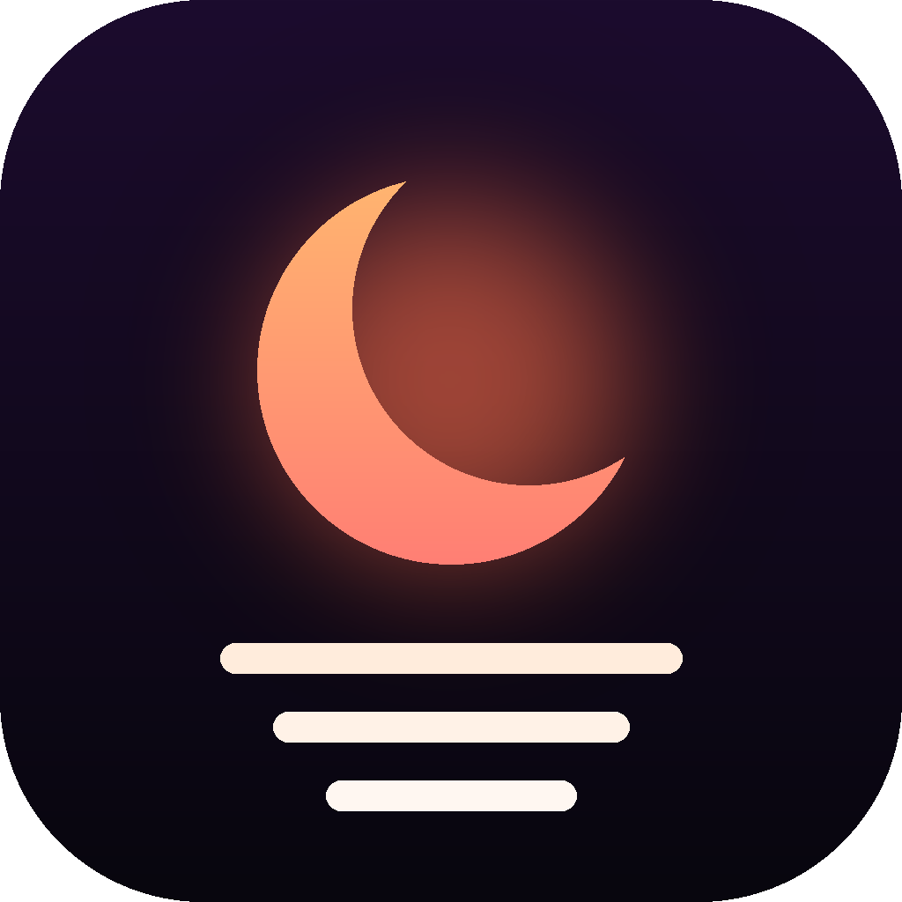
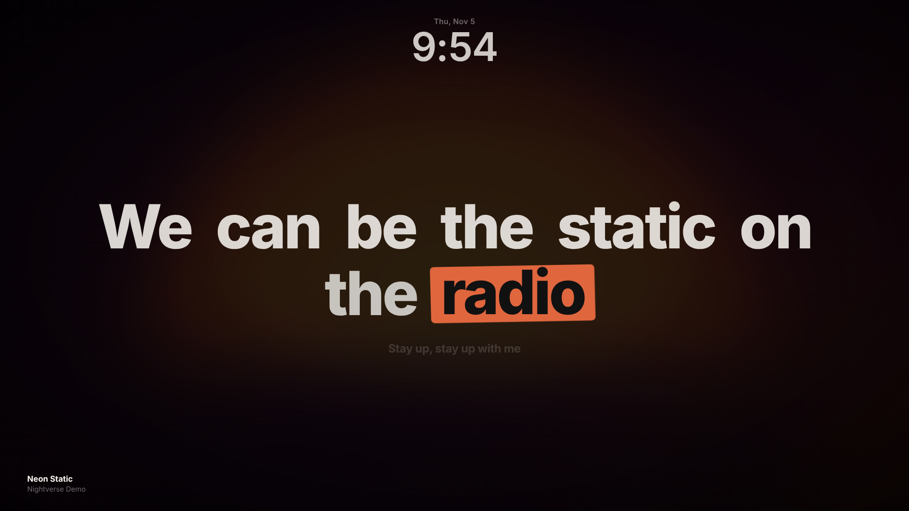
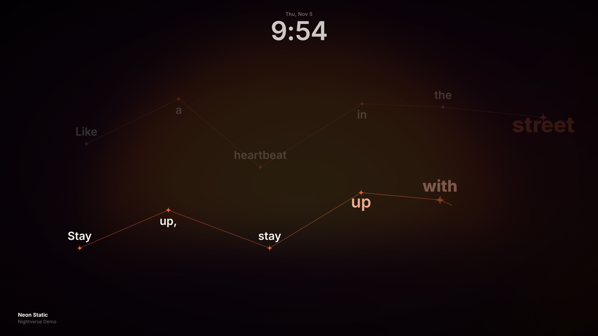
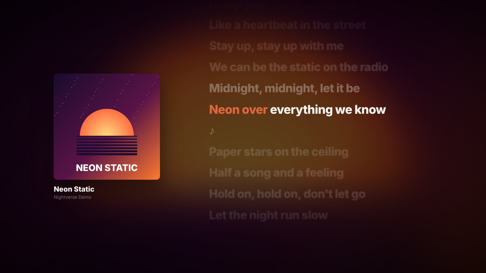
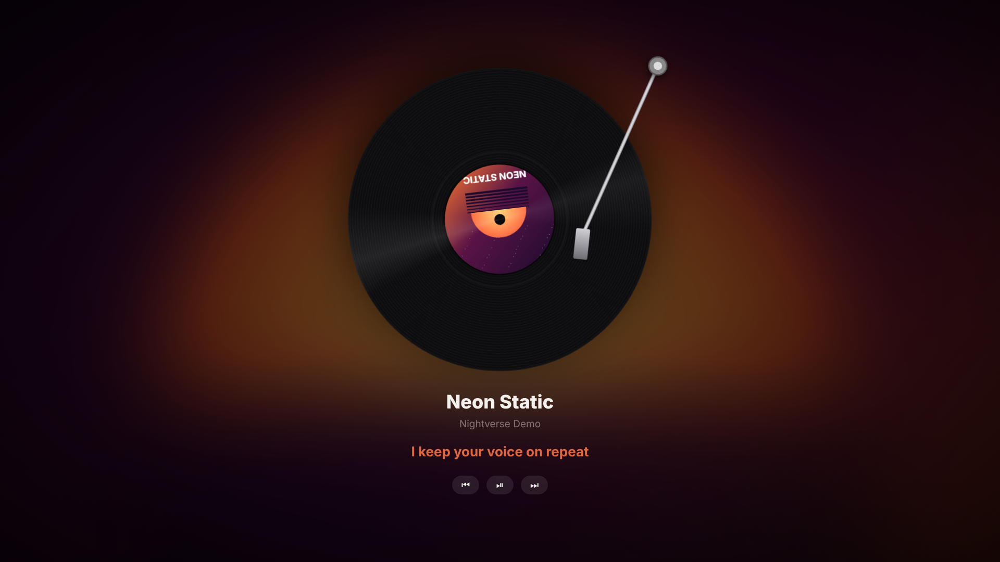

<p align="center"></p>

<h1 align="center">Nightverse</h1>
<p align="center"><b>Animated, synced lyrics and screen glow for whatever you're playing.</b><br>
Works with Spotify desktop, YT Music, Apple Music and any app that shows up in the Windows media controls. No login, no API keys.</p>

<p align="center"> <br>
 </p>

## What you get

| | |
|---|---|
| **Kinetic** | One line at a time; the word being sung gets a highlighter box in the album's colour |
| **Constellation** | Words appear as stars and are joined by lines as they're sung |
| **Classic** | Cover art + a scrolling lyric sheet with the current line in focus (also shows unsynced lyrics) |
| **Vinyl** | A spinning record with the cover as its label; the tonearm lifts when you pause |
| **Screen glow** | A soft, click-through glow around your screen edges, coloured from the album art (Windows app) |
| **Mini player** | A small always-on-top vinyl player for the corner of your screen (Windows app) |

## Get it

- **Windows 10/11:** Microsoft Store *(link after the first release)* or the portable zip from [Releases](../../releases).
- **YT Music in Chrome / Edge:** Edge Add-ons / Chrome Web Store *(links after review)*, or load it yourself (below).

## How it works

```
Spotify / YT Music / any player ──► Windows media session (SMTC) ──► Nightverse (C#)
                                                                        │   ▲
                                                     title, artist ──►  │   │ ◄── synced lyrics
                                                                        ▼   │
                                                                       lrclib.net
                                       WebView2 UI ◄── track + lyrics + position (60 fps clock)
```

- **Now playing** comes from Windows' System Media Transport Controls, the same data behind the volume flyout. That's why Spotify works without the Spotify Web API (which since 2026 caps new apps at 5 users).
- **Lyrics** come from [LRCLIB](https://lrclib.net), a free, community-run database of time-synced lyrics. Nothing is bundled; lyrics are fetched live and cached on your PC. Missing a song? Add it on LRCLIB and it shows up for everyone.
- **The animations** are plain HTML/CSS/JS in [`packages/renderer`](packages/renderer). The same files run inside the Windows app (WebView2) and the browser extension.

## Repo layout

```
apps/desktop/        Windows app: C# .NET 8 (WPF) + WebView2, SMTC reader, glow overlay, tray
apps/extension/      Manifest V3 extension for music.youtube.com
packages/renderer/   Shared lyric renderer (themes, LRC parser, sync clock)
packaging/           MSIX manifest, Store logos, build-msix.ps1
docs/                Icon, screenshots, privacy policy (GitHub Pages)
scripts/             Extension build + parser tests
```

## Run it yourself

**Preview the animations (any OS):** open `packages/renderer/index.html` in a browser. It plays a built-in demo song. Keys: `T` style, `C` clock, `H` help.

**Windows app** (needs the [.NET 8 SDK](https://dotnet.microsoft.com/download/dotnet/8.0)):

```powershell
dotnet run --project apps/desktop
```

Play something in Spotify or YT Music. The app lives in the tray; right-click it for styles, glow, mini player and start-with-Windows.

**Install as an MSIX locally** (needs the Windows SDK: `winget install Microsoft.WindowsSDK.10.0.22621`):

```powershell
./packaging/build-msix.ps1 -Sideload
```

**Browser extension:**

```bash
node scripts/build-extension.mjs        # copies the renderer into the extension
```

Then open `chrome://extensions` or `edge://extensions`, turn on **Developer mode**, click **Load unpacked** and pick `apps/extension`. Open music.youtube.com and press the **Lyrics** button (or `Alt+L`).

## Shortcuts

| Key | Action |
|---|---|
| `T` / `Shift+T` | Next / previous lyric style |
| `Space`, `←`, `→` | Play/pause, previous, next |
| `F` | Full screen |
| `G` | Screen glow (Windows) |
| `M` | Mini vinyl player (Windows) |
| `C` | Clock |
| `H` | Help |

## Publishing (maintainer notes)

1. Microsoft Store: reserve the name in Partner Center, copy *Product identity* values into repo variables `STORE_IDENTITY_NAME`, `STORE_PUBLISHER`, `STORE_PUBLISHER_DISPLAY_NAME`, push a `v1.0.0` tag and upload the `.msix` from the release. Screenshots are in `docs/screenshots`, the 300×300 tile in `docs/store-tile-300.png`, and the privacy policy in `docs/privacy.md`.
2. Edge Add-ons / Chrome Web Store: upload `out/nightverse-extension.zip` from the release.

## Credits & license

Lyrics from [LRCLIB](https://lrclib.net). Inspired by the cosy "late night music setup" videos. Code is [MIT](LICENSE). Not affiliated with Spotify or YouTube.
